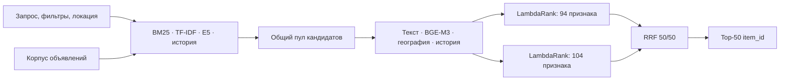

# Service Retrieval

Гибридный поиск объявлений об услугах по коротким запросам на русском языке.
Проект объединяет лексический поиск, нейросетевые представления текста и
обучаемый отбор кандидатов с учётом географии, фильтров и истории взаимодействий.

**Recall@50 на внешнем бенчмарке — 0.914682.** Корпус: **189 212 объявлений**;
обучающие данные: **497 673 пары «запрос — выбранное объявление»**.

[Notebook](solution.ipynb) · [Устройство поиска](docs/SOLUTION.md) ·
[Эксперименты](docs/EXPERIMENTS_V11.md) ·
[Веса и воспроизводимый релиз](https://drive.google.com/file/d/1tTm7Tkl_Mw-T3A8cxxqlqpwbRLjXV4hN/view?usp=drive_link)

## Задача

Запросы вроде «автоподбор», «баня на дровах» или «монтаж видеодомофонов»
содержат мало текста. Нужную услугу приходится находить с учётом синонимов,
параметров объявления и расположения исполнителя.

Система получает запрос и его контекст, затем возвращает до 50 уникальных
`item_id` для последующего ранжирования. Целевая метрика — средний по запросам
Recall@50: доля выбранных пользователями объявлений, попавших в кандидаты.

## Архитектура



Лексические и семантические каналы формируют широкий пул. Дообученный
query encoder E5 работает с замороженными векторами объявлений; BGE-M3
добавляет сигнал семантического сходства при отборе. Два ранкера LightGBM
используют текстовые признаки, историю, категорию и географию. Второй ранкер
дополнительно учитывает вид услуги, выезд и дистанционный формат работы.

Финальный ранкер обучен на **39,67 млн пар из 52 943 групп**. Ранги моделей
объединяются reciprocal rank fusion, после чего выбираются 50 объявлений.

## Результаты и валидация

| Версия | Локальный matched Recall@50 | Внешний бенчмарк Recall@50 |
| --- | ---: | ---: |
| v10: базовый гибридный каскад | 0.959901 | 0.911829 |
| v11: структурные признаки и ансамбль | **0.961181** | **0.914682** |

Локальная оценка отдельно учитывает новые тексты запросов и знакомые тексты
в новом контексте. Собственные взаимодействия контрольного запроса исключаются
из исторических признаков, а качество считается на полном пуле кандидатов.
Различия локального и внешнего протоколов разобраны в
[журнале экспериментов](docs/EXPERIMENTS_V11.md).

Релиз v11 проверен из свежей распаковки на CPU с отключённой сетью:
повторный запуск создал побайтово тот же `answer.csv`.

## Данные

Проект использует [датасет Avito по поиску услуг](https://disk.yandex.ru/d/sNhfo0YOjGtufg).
Положительная метка означает наблюдаемый выбор пользователя. Отсутствие
взаимодействия само по себе не доказывает нерелевантность объявления.

| Файл | Содержимое |
| --- | --- |
| `train.parquet` | 497 673 пары с признаками запросов и объявлений |
| `benchmark_items.parquet` | Корпус из 189 212 объявлений |
| `benchmark_queries.parquet` | 2 452 запроса для внешней оценки |

Исходные Parquet-файлы и большие веса хранятся отдельно от Git.

## Воспроизведение

1. Скачайте и распакуйте
   [релиз v11 с кодом, весами и векторами](https://drive.google.com/file/d/1tTm7Tkl_Mw-T3A8cxxqlqpwbRLjXV4hN/view?usp=drive_link)
   — `solution_v11.zip`, 4,61 ГБ.
2. Положите три исходных Parquet-файла рядом с `solution.ipynb`.
3. Установите зависимости в окружение notebook:

   ```bash
   python -m pip install -r requirements.txt
   ```

4. Откройте `solution.ipynb` в Jupyter или VS Code и выполните
   **Restart Kernel → Run All**. Результат появится в `answer.csv`.

Инференс использует локальные модели и поддерживает CPU. Для нейросетевых
экспериментов использовалась ноутбучная RTX 5070 Ti с 12 ГБ видеопамяти.
Веса зафиксированы в `config/solution_v11.json`, notebook проверяет
контрольную сумму результата.

<details>
<summary>Контрольные суммы релиза</summary>

SHA-256 `solution_v11.zip`:
`337da2857e4e89d3a2527020c7828e19256aad63e38b8252fbd26e31651fd508`.

SHA-256 `answer.csv`:
`8ce7401347beb1806f962ae1e72999fa93c89201b1044cd2433494f50e837d7e`.

</details>

## Навигация по проекту

| Путь | Назначение |
| --- | --- |
| [`solution.ipynb`](solution.ipynb) | Подготовка данных, поиск, признаки и инференс |
| [`docs/SOLUTION.md`](docs/SOLUTION.md) | Техническое описание, анализ ошибок и ограничения |
| [`docs/EXPERIMENTS_V11.md`](docs/EXPERIMENTS_V11.md) | Абляции финального каскада |
| [`config/`](config/) | Конфигурации и контрольные суммы артефактов |
| [`.development/`](.development/) | Код обучения, признаки и инструменты проверки |
| [`experiments/`](experiments/) | Notebook и результаты исследовательских версий |
| [`archive/`](archive/) | История ранних подходов |

Основная точка запуска — `solution.ipynb`. Промежуточные обучающие матрицы
старых экспериментов не входят в релиз и пересчитываются при повторном обучении.

**Стек:** Python, PyTorch, Transformers, E5, BGE-M3, LightGBM, pandas, NumPy,
SciPy и scikit-learn. Версии зависимостей — в [`requirements.txt`](requirements.txt).
